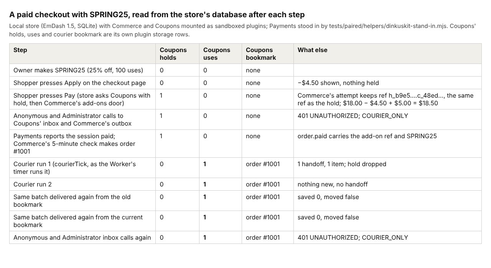

# A paid checkout, counted by the courier

Taken on 24 Nov 2026 on a fresh local store (EmDash 1.5, SQLite) from dinkuskit/template-store#271's `scripts/dev-fresh.sh`, with this plugin (5cf5bc6) and Commerce from dinkuskit/commerce#306 (2d8927e) mounted as sandboxed plugins. Payments was stood in by template-store's `tests/paired/helpers/dinkuskit-stand-in.mjs`, with a "paid" answer added in the proof's own copy. Every other step is the real code: the store's checkout form, Coupons' `checkout/answer`, Commerce's add-ons door, Commerce's 5-minute check (EmDash's scheduler), its `courier/outbox`, the courier's `courierTick()` and this plugin's `courier/inbox`. Rows were read from the store's database after each step. The full log is [trace.txt](trace.txt).

| Step | Result |
| --- | --- |
| The owner makes SPRING25 (25% off, 100 uses) | Saved; 0 holds, 0 uses |
| The shopper presses Apply | −$4.50 shown; nothing held (`paid-1-applied.jpg`) |
| The shopper presses Pay | The store asks with `hold: true`: one hold row, ref `h_b9e5bf55222a46ddcb10.c_48ed8b37dfb07e6a3fba`. Commerce's checkout keeps `addons: [{ from: "dinkus-coupons", ref: <the same>, codes: ["SPRING25"] }]` and prices $18.00 − $4.50 + $5.00 = $18.50; the shopper goes to the Stripe address (`paid-2-sent-to-stripe.jpg`) |
| Before payment: an anonymous caller, then the signed-in Administrator, post a forged `order.paid` delivery to `courier/inbox`, and read Commerce's `courier/outbox` | `401 UNAUTHORIZED`, then `COURIER_ONLY`, for both doors. Still 1 hold, 0 uses, no bookmark |
| Payments reports the session paid | Commerce's 5-minute check makes order #1001; its `order.paid` news carries the same ref and SPRING25 |
| The courier's first run | 1 handoff, 1 item. The hold is gone, one use `order:574c…:c_48ed…` is saved, and the bookmark moves to the order |
| The courier's second run | No handoff; still 1 use |
| The same batch delivered again from the old bookmark, then from the current one | `saved: 0, moved: false` both times; still 1 use, bookmark unchanged |
| An anonymous caller, then the Administrator, post to `courier/inbox` again | `401 UNAUTHORIZED`, then `COURIER_ONLY`; still 1 use |

The use is a test order (`test: true`), because the stand-in binding is a Stripe test binding. The coupon's page counts paid orders only, so it shows "Used 0 · Paid orders; test orders aren't counted" (`paid-4-coupon-detail.jpg`). A live order counts.

## What the run found

The template pinned a courier that matched senders by plugin id only, so it reported nothing for `from: "dinkus-commerce"` in a store where Commerce has a Registry id. dinkuskit/courier#4 looks senders up by EmDash's `registry_slug`, and template-store#271 now pins it. A Node dev store has no Cloudflare timer, so this proof ran the same `courierTick()` from a throwaway dev route, naming Commerce with the courier's `senders` option, since a locally mounted plugin has no `registry_slug`.

Not proven here: a real Stripe payment. A beta store run is the next check.
